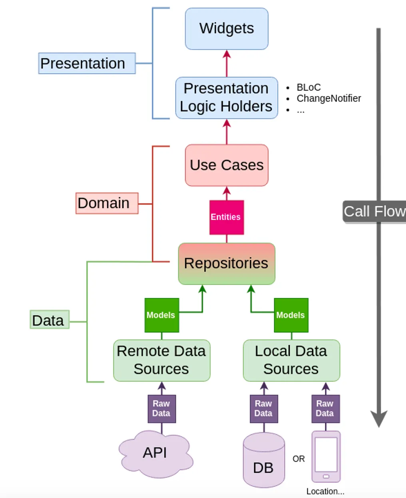
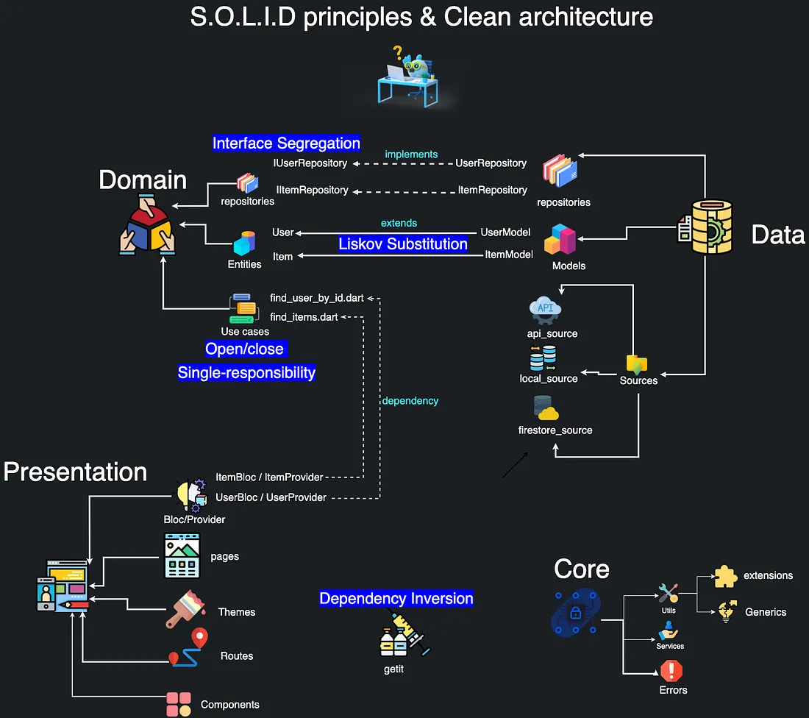

# Blog App

Just a simple learning project, coded manually - nothing special.

A Flutter blog app with **Supabase** backend (auth + storage + database), **Clean Architecture** layering, **BLoC** for state management and **GetIt** for dependency injection.

> Status: **auth feature implemented** (signup / login / session restore via Supabase) and **blog feature implemented** (create / list / view blogs, image upload to Supabase Storage, offline cache with Hive).

---

## 1. Project Structure

The project uses a **feature-first** layout with shared code promoted to `core/`:

```
lib/
├── main.dart                        # App entry - wires cubits/blocs via BlocProvider
├── init_dependencies.dart           # GetIt wiring (service locator) - one point of entry
├── core/                            # Shared, reusable code (not feature-specific)
│   ├── common/
│   │   ├── cubits/app_user/         # AppUserCubit + state - holds the logged-in user app-wide
│   │   ├── entities/user.dart       # User domain entity (pure Dart, no JSON)
│   │   └── widgets/loader.dart      # Shared loading spinner
│   ├── error/
│   │   ├── exceptions.dart          # ServerException (data layer)
│   │   └── failures.dart            # Failure (domain layer contract)
│   ├── secrets/
│   │   ├── app_secrets.example.dart # Committed placeholder with dummy values
│   │   └── app_secrets.dart         # Real Supabase keys - GITIGNORED, local only
│   ├── theme/                       # AppTheme + AppPallet (colors)
│   ├── usecase/usecase.dart         # UseCase<T, Params> + NoParams contract
│   └── utils/show_snackbar.dart     # showSnackBar helper
└── features/                        # One folder per feature
    ├── auth/
    │   ├── data/
    │   │   ├── datasources/
    │   │   │   └── auth_remote_data_source.dart      # abstract + Supabase impl
    │   │   ├── models/
    │   │   │   └── user_model.dart                  # UserModel extends User
    │   │   └── repositories/
    │   │       └── auth_repository_impl.dart        # data → domain mapping
    │   ├── domain/
    │   │   ├── repository/
    │   │   │   └── auth_repository.dart             # abstract interface
    │   │   └── usecases/
    │   │       ├── user_sign_up.dart
    │   │       ├── user_login.dart
    │   │       └── current_user.dart
    │   └── presentation/
    │       ├── bloc/
    │       │   ├── auth_bloc.dart                   # part file
    │       │   ├── auth_event.dart                  # part file
    │       │   └── auth_state.dart                  # part file
    │       ├── pages/
    │       │   ├── signup_page.dart
    │       │   └── login_page.dart
    │       └── widgets/
    │           ├── auth_form_field.dart
    │           └── auth_gradient_button.dart
    └── blog/
        ├── data/
        │   ├── datasources/
        │   │   ├── blog_remote_data_source.dart      # abstract + Supabase impl
        │   │   └── blog_local_data_source.dart       # Hive box cache
        │   ├── models/
        │   │   └── blog_model.dart                  # BlogModel extends Blog
        │   └── repositories/
        │       └── blog_repository_impl.dart        # data → domain mapping + offline switch
        ├── domain/
        │   ├── entities/blog.dart                   # Blog entity (pure Dart)
        │   ├── repository/
        │   │   └── blog_repository.dart             # abstract interface
        │   └── usecases/
        │       ├── upload_blog.dart
        │       └── get_all_blogs.dart
        └── presentation/
            ├── bloc/
            │   ├── blog_bloc.dart                   # part file
            │   ├── blog_event.dart                  # part file
            │   └── blog_state.dart                  # part file
            ├── pages/
            │   ├── blog_page.dart
            │   ├── add_new_blog_page.dart
            │   └── blog_viewer_page.dart
            └── widgets/
                ├── blog_card.dart
                └── blog_editor.dart
```

**Why:** grouping by feature (`features/auth/`, `features/blog/`) means everything that changes together stays near each other, and adding a new vertical is just another folder. Code shared across features is pulled up into `core/` so it isn't duplicated. This is the canonical Flutter Clean-Architecture layout.

---

## 2. Clean Architecture Layers

The code is split into three layers per feature, and dependencies point **inward** (presentation → domain → data, all through `core/`):

```
Presentation (pages, bloc, widgets)
      │  dispatches events
      ▼
Domain (repository interface + usecases + entity)
      │  depends on an interface, not the implementation
      ▼
Data (remote datasource, models, repository impl)
```



### Domain layer (pure Dart)
- `AuthRepository` - abstract interface returning `Either<Failure, User>`.
- Usecases (`UserSignUp`, `UserLogin`, `CurrentUser`) - thin, they delegate a single repository call and implement a shared `UseCase<T, Params>`.
- `User` entity lives in `core/common/entities/` - **no Flutter, no Supabase, no JSON** imports here.
- `BlogRepository` + usecases (`UploadBlog`, `GetAllBlogs`) follow the same pattern; the `Blog` entity lives in `features/blog/domain/entities/`.

### Data layer
- `AuthRemoteDataSource` is the abstract contract; `AuthRemoteDataSourceImpl` talks to Supabase.
- `UserModel` **extends** the `User` entity and adds `fromJson`/`toJson` - the domain stays JSON-free.
- `AuthRepositoryImpl` wraps the datasource and converts `ServerException → Failure`, returning `left(...)/right(...)`.
- For blog there are **two** datasources: `BlogRemoteDataSourceImpl` (Supabase DB + Storage) and `BlogLocalDataSourceImpl` (Hive cache). `BlogModel` extends `Blog`, and `BlogRepositoryImpl` picks the source based on connectivity and rolls back the image upload with `runWithRollback` if the blog insert fails.

### Presentation layer
- `AuthBloc` orchestrates usecases and emits a sealed `AuthState` (Initial / Loading / Success / Failure).
- `AppUserCubit` (a global cubit) holds the logged-in `User` for the whole app; `AuthBloc` updates it on success.
- `BlogBloc` handles `BlogUploadEvent` and `BlogFetchEvent` and emits sealed states (`BlogLoading`, `BlogUploadSuccess`, `BlogDisplaySuccess`, `BlogFailure`).
- Pages are plain widgets: they dispatch events and react to state. No business logic lives in the UI.

**Why:** the dependency rule means the UI only knows an interface (`AuthRepository`), never the datasource or Supabase directly. That keeps the domain testable and swappable (e.g. a mock repo), and the layer boundaries are what make the app maintainable as features grow. The layers follow the SOLID principles, applied to this codebase:



**How each principle maps to the code:**
- **S - Single Responsibility**: layered classes each do one thing (`AuthRepository` defines contracts, usecases orchestrate, `AuthBloc` handles state, widgets render).
- **O - Open/Closed**: sealed BLoC states and `abstract interface` repositories allow new states/implementations without changing consumers.
- **L - Liskov**: `UserModel extends User`, so any code expecting a `User` can be given a `UserModel`.
- **I - Interface Segregation**: usecases consume the small, focused `AuthRepository` interface rather than one fat service.
- **D - Dependency Inversion**: presentation depends on the abstract `AuthRepository`, and GetIt injects `AuthRepositoryImpl` - high-level code never references the concrete Supabase impl directly.

---

## 3. DI with GetIt

All wiring lives in `init_dependencies.dart` (split into a `part 'init_dependencies.main.dart'`) using a single GetIt instance (`sl`):

```dart
sl.registerFactory<AuthRemoteDataSource>(() => AuthRemoteDataSourceImpl(sbClient: sl()));
sl.registerFactory<AuthRepository>(() => AuthRepositoryImpl(authRemoteDataSource: sl()));

sl.registerFactory(() => UserSignUp(authRepository: sl()));
sl.registerFactory(() => UserLogin(authRepository: sl()));
sl.registerFactory(() => CurrentUser(authRepository: sl()));

sl.registerLazySingleton(() => AuthBloc(userSignUp: sl(), userLogin: sl(), currentUser: sl(), appUserCubit: sl()));

sl.registerFactory<ConnectionChecker>(() => ConnectionCheckerImpl(sl()));
sl.registerFactory<BlogRemoteDataSource>(() => BlogRemoteDataSourceImpl(sbClient: sl()));
sl.registerFactory<BlogLocalDataSource>(() => BlogLocalDataSourceImpl(box: sl()));
sl.registerFactory<BlogRepository>(() => BlogRepositoryImpl(
  connectionChecker: sl(),
  blogRemoteDataSource: sl(),
  blogLocalDataSource: sl(),
));

sl.registerFactory(() => UploadBlog(blogRepository: sl()));
sl.registerFactory(() => GetAllBlogs(blogRepository: sl()));

sl.registerLazySingleton(() => BlogBloc(uploadBlog: sl(), getAllBlogs: sl()));
```

**Why:** dependencies are constructor-injected top-down (`sl()` resolves lazily at call time), so nothing is hard-wired inside widgets and the same usecases/repositories can be swapped for mocks in tests. GetIt is a small, dependency-light service locator.

---

## 4. Secrets Management

- The real `app_secrets.dart` (Supabase URL + anon key) is **gitignored** and untracked - it exists only locally, never pushed.
- `app_secrets.example.dart` is committed with placeholder values so a new developer knows exactly what fields to fill and their shape.

**Why:** credentials stay out of version control while keeping the example (and the expected structure) inside the repo for discoverability. On a fresh clone you copy `app_secrets.example.dart → app_secrets.dart` and fill the real values.

---

## 5. Theme & Shared Widgets

- `core/theme/app_pallet.dart` - the color palette (`AppPallet`).
- `core/theme/theme.dart` - `AppTheme.darkTheme` (dark Material theme, app bar and gradient input borders).
- `core/common/widgets/loader.dart` - reusable `Loader`.
- `core/utils/show_snackbar.dart` - global `showSnackBar` helper used by both pages.
- `core/constants/constants.dart` - blog `topics` list + `noConnectionMessage`.
- `core/network/connection_checker.dart` - abstracts `InternetConnection.hasInternetAccess` behind a `ConnectionChecker` interface.
- `core/utils/` - `calculate_reading_time.dart`, `format_data.dart`, `pick_image.dart` (image picker wrapper) and `run_with_rollback.dart` (run an action, undo it on failure).
- `core/extension/` - `context.nav` shortcut for navigation.
- Auth UI widgets (`AuthFormField`, `AuthGradientButton`) and blog UI widgets (`BlogCard`, `BlogEditor`) are shared within their own features.

**Why:** presentational building blocks are centralized in `core/` rather than re-created per page, so styling stays consistent and changes to the palette/theme propagate everywhere.

---

## 6. Auth Feature Flow

The user creates an account, logs in, and the app restores the session on launch:

1. **On app start** - `main.dart` dispatches `AuthUserLoggedIn`; the `CurrentUser` usecase checks Supabase for an existing session and, if present, updates `AppUserCubit` + emits `AuthSuccess`.
2. **Signup** - `SignupPage` validates the form, dispatches `AuthSignUp(name, email, password)`; `AuthBloc` runs `UserSignUp` → repository → Supabase; on success updates `AppUserCubit` and shows the Home page; on failure shows a snackbar.
3. **Login** - `LoginPage` dispatches `AuthLogin(email, password)`; `AuthBloc` runs `UserLogin` with the same Either/Failure pattern.

```
SignupPage ──AuthSignUp──▶ AuthBloc ──UserSignUp usecase──▶ AuthRepository
      ▲                                                        │
      └────── AuthSuccess/AuthFailure ◀── AppUserCubit ◀──────┘
```

**Why:** every path returns `Either<Failure, User>` from the repository, so the bloc paints `AuthFailure` messages straight into a snackbar - uniform, predictable error handling with no exceptions leaking past the repository boundary.

---

## 7. Blog Feature Flow

Once logged in, the app lands on `BlogPage`, which shows all blogs and lets you add new ones with an image:

1. **List (online)** - `BlogPage` dispatches `BlogFetchEvent`; `BlogBloc` runs `GetAllBlogs` → `BlogRepositoryImpl.getAllBlogs()`. Online, it fetches from Supabase and caches the result into the Hive box.
2. **List (offline)** - if `ConnectionChecker.isConnected` is false, `getAllBlogs()` reads from the `BlogLocalDataSource` (Hive) instead and returns whatever was cached, so the list still renders without internet.
3. **Add blog** - `AddNewBlogPage` picks an image (`pick_image.dart`) and dispatches `BlogUploadEvent(title, content, posterId, image, topics)`. The repository generates a `Uuid().v1()` id, uploads the image to Supabase Storage, then inserts the blog row. If the insert fails, `runWithRollback` deletes the just-uploaded image so no orphans remain.
4. **View** - tapping a `BlogCard` pushes `BlogViewerPage`, which renders the title, poster name, formatted date + estimated reading time (`calculate_reading_time`), cover image and body.

```
BlogPage ──BlogFetchEvent──▶ BlogBloc ──GetAllBlogs──▶ BlogRepository (online → Supabase, offline → Hive)
   ▲                                                      │
   └── BlogDisplaySuccess(blogs) ◀──── Either<Failure, List<Blog>> ──────┘

BlogUploadEvent ──▶ BlogBloc ──UploadBlog──▶ BlogRepository ──▶ [upload image → insert blog]
                                                  │                      │ failure
                                                  └───── runWithRollback deletes image ◀──┘
```

**Why:** the connectivity check keeps the UI working offline (Hive cache) and the rollback keeps the storage bucket clean if a DB insert fails - the blog repository owns that consistency, not the page.